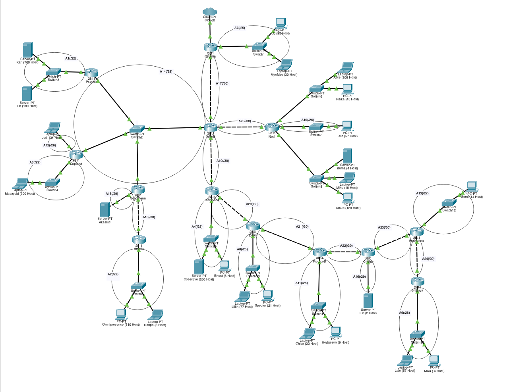
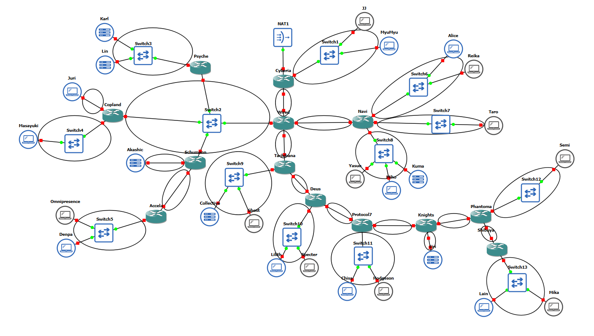
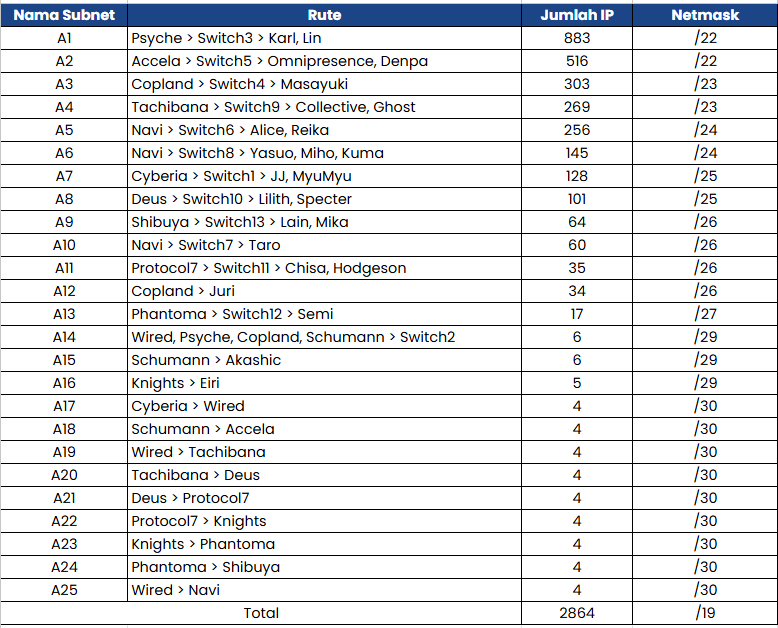
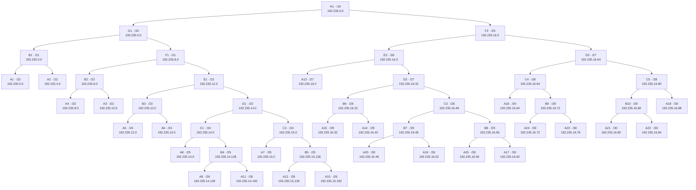
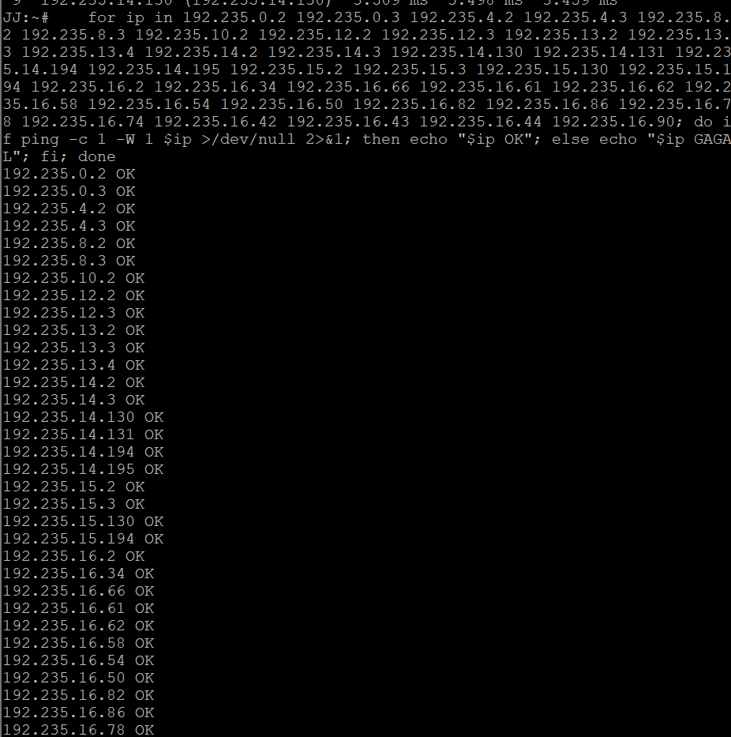
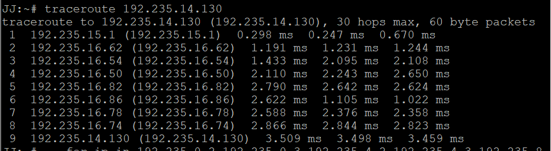
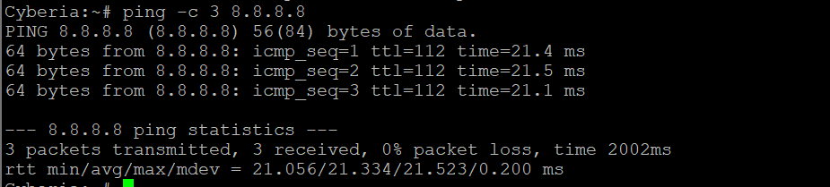

# PRAKTIKUM JARKOM MODUL 4 KELOMPOK 48

## Anggota Kelompok

| Nama | NRP |
| ---- | ---------- |
| Tafidah Hasna Mumtazah | 5027251025 |
| Iqbal Rizki Muhammad Fadhli | 5027251027 |

## Laporan

[LINK SPREADSHEET]
[https://docs.google.com/spreadsheets/d/1n1k3TZ-7_DHkZ-9TRGMoIxMExmKdflAO/edit?usp=sharing](https://docs.google.com/spreadsheets/d/1n1k3TZ-7_DHkZ-9TRGMoIxMExmKdflAO/edit?usp=sharing&ouid=100753144285613856708&rtpof=true&sd=true)

### CPT - VLSM

1. Berikut topologi yang dibuat untuk Cisco Packet Tracer.

   

   Setelah dilakukan analisa terhadap topologi tersebut, dapat disimpulkan terdapat sebanyak **25 subnet** (A1 - A25) yang perlu dilakukan. Terdiri dari 13 router, 13 switch, dan 1 cloud (uplink Cyberia).

   > Catatan: label subnet A5 (Switch6) dan A6 (Switch8) tidak tertulis pada gambar topologi; prefix keduanya (/24) mengikuti perhitungan pada spreadsheet.

2. Perhitungan kebutuhan subnet.

   Untuk tiap subnet, jumlah IP yang dibutuhkan = **jumlah host + 1 gateway (router) + 1 Network ID + 1 Broadcast** (sesuai spreadsheet). Prefix dicari dengan rumus $2^n \geq \text{kebutuhan IP}$, dan prefix CIDR = $32 - n$. Link antar router (A17 - A25) memakai **/30** karena hanya membutuhkan 2 IP router.

   | Subnet | Lokasi / Keterangan | Host | Jumlah IP Dibutuhkan | Prefix | Total IP | IP Usable |
   | ------ | ------------------- | ---- | -------------------- | ------ | -------- | --------- |
   | A1 | Switch3 (Karl 700 + Lin 180) | 880 | 883 | /22 | 1024 | 1022 |
   | A2 | Switch5 (Omnipresence 510 + Denpa 3) | 513 | 516 | /22 | 1024 | 1022 |
   | A3 | Switch4 (Masayuki 300) | 300 | 303 | /23 | 512 | 510 |
   | A4 | Switch9 (Collective 260 + Ghost 6) | 266 | 269 | /23 | 512 | 510 |
   | A5 | Switch6 (Alice 208 + Reika 45) | 253 | 256 | /24 | 256 | 254 |
   | A6 | Switch8 (Kuma 4 + Miho 18 + Yasuo 120) | 142 | 145 | /24 | 256 | 254 |
   | A7 | Switch1 (JJ 95 + MyuMyu 30) | 125 | 128 | /25 | 128 | 126 |
   | A8 | Switch10 (Lilith 77 + Specter 21) | 98 | 101 | /25 | 128 | 126 |
   | A9 | Switch13 (Lain 57 + Mika 4) | 61 | 64 | /26 | 64 | 62 |
   | A10 | Switch7 (Taro 57) | 57 | 60 | /26 | 64 | 62 |
   | A11 | Switch11 (Chisa 23 + Hodgeson 9) | 32 | 35 | /26 | 64 | 62 |
   | A12 | Laptop Juri (31) | 31 | 34 | /26 | 64 | 62 |
   | A13 | Switch12 (Semi 14) | 14 | 17 | /27 | 32 | 30 |
   | A14 | Switch2 (Psyche, Copland, Schumann, Wired) | 4 | 6 | /29 | 8 | 6 |
   | A15 | Server Akashic | 1 | 6 | /29 | 8 | 6 |
   | A16 | Server Eiri (2) | 2 | 5 | /29 | 8 | 6 |
   | A17 | Cyberia - Wired | - | 4 | /30 | 4 | 2 |
   | A18 | Schumann - Accela | - | 4 | /30 | 4 | 2 |
   | A19 | Wired - Tachibana | - | 4 | /30 | 4 | 2 |
   | A20 | Tachibana - Deus | - | 4 | /30 | 4 | 2 |
   | A21 | Deus - Protocol7 | - | 4 | /30 | 4 | 2 |
   | A22 | Protocol7 - Knights | - | 4 | /30 | 4 | 2 |
   | A23 | Knights - Phantoma | - | 4 | /30 | 4 | 2 |
   | A24 | Phantoma - Shibuya | - | 4 | /30 | 4 | 2 |
   | A25 | Wired - Navi | - | 4 | /30 | 4 | 2 |

   Total subnet yang digunakan adalah **25 subnet** dengan total kebutuhan IP **2864 IP** dan total blok teralokasi **4188 IP**. Karena setiap subnet harus rata di kelipatan block size-nya (VLSM), blok yang terpakai membengkak menjadi 4188 IP yang melewati batas /20 (4096 IP), sehingga pendekatan terkecil yang cukup adalah **/19** (8192 IP). Dipakai blok induk **`192.235.0.0/19`** (rentang `192.235.0.0` - `192.235.31.255`), dan alokasi terpakai sampai `192.235.16.91`.

3. Pembagian IP (VLSM).

   Subnet diurutkan dari **kebutuhan terbesar ke terkecil**, lalu dialokasikan berurutan dari awal blok `192.235.0.0/19` (setiap subnet harus rata di kelipatan block size-nya).

   | Urutan | Subnet | Prefix | Network ID | Range IP Usable | Broadcast |
   | ------ | ------ | ------ | ---------- | --------------- | --------- |
   | 1 | A1 | /22 | `192.235.0.0` | `192.235.0.1` - `192.235.3.254` | `192.235.3.255` |
   | 2 | A2 | /22 | `192.235.4.0` | `192.235.4.1` - `192.235.7.254` | `192.235.7.255` |
   | 3 | A3 | /23 | `192.235.8.0` | `192.235.8.1` - `192.235.9.254` | `192.235.9.255` |
   | 4 | A4 | /23 | `192.235.10.0` | `192.235.10.1` - `192.235.11.254` | `192.235.11.255` |
   | 5 | A5 | /24 | `192.235.12.0` | `192.235.12.1` - `192.235.12.254` | `192.235.12.255` |
   | 6 | A6 | /24 | `192.235.13.0` | `192.235.13.1` - `192.235.13.254` | `192.235.13.255` |
   | 7 | A7 | /25 | `192.235.14.0` | `192.235.14.1` - `192.235.14.126` | `192.235.14.127` |
   | 8 | A8 | /25 | `192.235.14.128` | `192.235.14.129` - `192.235.14.254` | `192.235.14.255` |
   | 9 | A9 | /26 | `192.235.15.0` | `192.235.15.1` - `192.235.15.62` | `192.235.15.63` |
   | 10 | A10 | /26 | `192.235.15.64` | `192.235.15.65` - `192.235.15.126` | `192.235.15.127` |
   | 11 | A11 | /26 | `192.235.15.128` | `192.235.15.129` - `192.235.15.190` | `192.235.15.191` |
   | 12 | A12 | /26 | `192.235.15.192` | `192.235.15.193` - `192.235.15.254` | `192.235.15.255` |
   | 13 | A13 | /27 | `192.235.16.0` | `192.235.16.1` - `192.235.16.30` | `192.235.16.31` |
   | 14 | A14 | /29 | `192.235.16.32` | `192.235.16.33` - `192.235.16.38` | `192.235.16.39` |
   | 15 | A15 | /29 | `192.235.16.40` | `192.235.16.41` - `192.235.16.46` | `192.235.16.47` |
   | 16 | A16 | /29 | `192.235.16.48` | `192.235.16.49` - `192.235.16.54` | `192.235.16.55` |
   | 17 | A17 | /30 | `192.235.16.56` | `192.235.16.57` - `192.235.16.58` | `192.235.16.59` |
   | 18 | A18 | /30 | `192.235.16.60` | `192.235.16.61` - `192.235.16.62` | `192.235.16.63` |
   | 19 | A19 | /30 | `192.235.16.64` | `192.235.16.65` - `192.235.16.66` | `192.235.16.67` |
   | 20 | A20 | /30 | `192.235.16.68` | `192.235.16.69` - `192.235.16.70` | `192.235.16.71` |
   | 21 | A21 | /30 | `192.235.16.72` | `192.235.16.73` - `192.235.16.74` | `192.235.16.75` |
   | 22 | A22 | /30 | `192.235.16.76` | `192.235.16.77` - `192.235.16.78` | `192.235.16.79` |
   | 23 | A23 | /30 | `192.235.16.80` | `192.235.16.81` - `192.235.16.82` | `192.235.16.83` |
   | 24 | A24 | /30 | `192.235.16.84` | `192.235.16.85` - `192.235.16.86` | `192.235.16.87` |
   | 25 | A25 | /30 | `192.235.16.88` | `192.235.16.89` - `192.235.16.90` | `192.235.16.91` |

   **VLSM Tree**

   ```text
   192.235.0.0/19
   ├── 192.235.0.0/21
   │   ├── 192.235.0.0/22    A1
   │   └── 192.235.4.0/22    A2
   ├── 192.235.8.0/21
   │   ├── 192.235.8.0/22
   │   │   ├── 192.235.8.0/23    A3
   │   │   └── 192.235.10.0/23   A4
   │   └── 192.235.12.0/22
   │       ├── 192.235.12.0/23
   │       │   ├── 192.235.12.0/24   A5
   │       │   └── 192.235.13.0/24   A6
   │       └── 192.235.14.0/23
   │           ├── 192.235.14.0/24
   │           │   ├── 192.235.14.0/25   A7
   │           │   └── 192.235.14.128/25 A8
   │           └── 192.235.15.0/24
   │               ├── 192.235.15.0/26   A9
   │               ├── 192.235.15.64/26  A10
   │               ├── 192.235.15.128/26 A11
   │               └── 192.235.15.192/26 A12
   └── 192.235.16.0/21   (sisa blok)
       ├── 192.235.16.0/27   A13
       ├── 192.235.16.32/29  A14
       ├── 192.235.16.40/29  A15
       ├── 192.235.16.48/29  A16
       ├── 192.235.16.56/30  A17
       ├── 192.235.16.60/30  A18
       ├── 192.235.16.64/30  A19
       ├── 192.235.16.68/30  A20
       ├── 192.235.16.72/30  A21
       ├── 192.235.16.76/30  A22
       ├── 192.235.16.80/30  A23
       ├── 192.235.16.84/30  A24
       ├── 192.235.16.88/30  A25
       └── 192.235.16.92 - 192.235.31.255  (belum terpakai)
   ```

   #### **Studi Kasus Perhitungan: Subnet A1**

   **a. Menentukan Prefix (CIDR)**
   * **Kebutuhan Host:** Karl 700 + Lin 180 = 880 host (+ 1 gateway + Network ID + Broadcast = 883 IP).
   * **Rumus:** $2^n \geq 883$
       * $2^9 = 512$ (Kurang)
       * $2^{10} = 1024$ (Cukup) $\rightarrow$ Maka, $n = 10$.
   * **Prefix CIDR:** $32 - 10 = \mathbf{/22}$.

   **b. Menghitung Block Size**
   * $2^{(32-22)} = 1024$ IP. Karena 1 oktet bernilai 256, maka $1024 / 256 = 4$ angka pada oktet ketiga.

   **c. Menentukan Network ID & Broadcast**
   * **Network ID:** A1 adalah subnet pertama (terbesar), sehingga NID dimulai dari **`192.235.0.0`**.
   * **Next Network:** $0 + 4 = 4$, subnet berikutnya mulai di `192.235.4.0`.
   * **Broadcast:** satu angka sebelum Next Network, yaitu **`192.235.3.255`**.

   **d. Range IP Usable**
   * **IP Pertama:** NID + 1 $\rightarrow$ **`192.235.0.1`** (gateway Psyche).
   * **IP Terakhir:** Broadcast - 1 $\rightarrow$ **`192.235.3.254`**.

4. Static routing.

   Pada praktikum ini hanya diharuskan melakukan static routing, sehingga tiap router harus dikonfigurasi manual agar mengetahui jalur ke subnet yang tidak terhubung langsung dengannya. Karena topologi berbentuk pohon (tanpa loop), setiap tujuan hanya punya satu jalur: cukup dilihat router tetangga mana yang mengarah ke subnet tujuan.

   **Pemetaan IP interface router** (IP pertama pada subnet = router yang disebut pertama pada link; gateway LAN = IP usable pertama):

   | Router | Subnet | IP Interface |
   | ------ | ------ | ------------ |
   | Cyberia | A7 (`192.235.14.0/25`) | `192.235.14.1` |
   | Cyberia | A17 (`192.235.16.56/30`) | `192.235.16.57` |
   | Wired | A14 (`192.235.16.32/29`) | `192.235.16.36` |
   | Wired | A17 (`192.235.16.56/30`) | `192.235.16.58` |
   | Wired | A19 (`192.235.16.64/30`) | `192.235.16.65` |
   | Wired | A25 (`192.235.16.88/30`) | `192.235.16.89` |
   | Navi | A5 (`192.235.12.0/24`) | `192.235.12.1` |
   | Navi | A6 (`192.235.13.0/24`) | `192.235.13.1` |
   | Navi | A10 (`192.235.15.64/26`) | `192.235.15.65` |
   | Navi | A25 (`192.235.16.88/30`) | `192.235.16.90` |
   | Tachibana | A4 (`192.235.10.0/23`) | `192.235.10.1` |
   | Tachibana | A19 (`192.235.16.64/30`) | `192.235.16.66` |
   | Tachibana | A20 (`192.235.16.68/30`) | `192.235.16.69` |
   | Deus | A8 (`192.235.14.128/25`) | `192.235.14.129` |
   | Deus | A20 (`192.235.16.68/30`) | `192.235.16.70` |
   | Deus | A21 (`192.235.16.72/30`) | `192.235.16.73` |
   | Protocol7 | A11 (`192.235.15.128/26`) | `192.235.15.129` |
   | Protocol7 | A21 (`192.235.16.72/30`) | `192.235.16.74` |
   | Protocol7 | A22 (`192.235.16.76/30`) | `192.235.16.77` |
   | Knights | A16 (`192.235.16.48/29`) | `192.235.16.49` |
   | Knights | A22 (`192.235.16.76/30`) | `192.235.16.78` |
   | Knights | A23 (`192.235.16.80/30`) | `192.235.16.81` |
   | Phantoma | A13 (`192.235.16.0/27`) | `192.235.16.1` |
   | Phantoma | A23 (`192.235.16.80/30`) | `192.235.16.82` |
   | Phantoma | A24 (`192.235.16.84/30`) | `192.235.16.85` |
   | Shibuya | A9 (`192.235.15.0/26`) | `192.235.15.1` |
   | Shibuya | A24 (`192.235.16.84/30`) | `192.235.16.86` |
   | Psyche | A1 (`192.235.0.0/22`) | `192.235.0.1` |
   | Psyche | A14 (`192.235.16.32/29`) | `192.235.16.33` |
   | Copland | A3 (`192.235.8.0/23`) | `192.235.8.1` |
   | Copland | A12 (`192.235.15.192/26`) | `192.235.15.193` |
   | Copland | A14 (`192.235.16.32/29`) | `192.235.16.34` |
   | Schumann | A14 (`192.235.16.32/29`) | `192.235.16.35` |
   | Schumann | A15 (`192.235.16.40/29`) | `192.235.16.41` |
   | Schumann | A18 (`192.235.16.60/30`) | `192.235.16.61` |
   | Accela | A2 (`192.235.4.0/22`) | `192.235.4.1` |
   | Accela | A18 (`192.235.16.60/30`) | `192.235.16.62` |

   Berikut tabel static route tiap router (format Cisco: `ip route <network> <netmask> <next-hop>`):

   
   <summary><b>Cyberia</b></summary>

   ```text
   ip route 192.235.0.0 255.255.252.0 192.235.16.58   ! A1
   ip route 192.235.4.0 255.255.252.0 192.235.16.58   ! A2
   ip route 192.235.8.0 255.255.254.0 192.235.16.58   ! A3
   ip route 192.235.10.0 255.255.254.0 192.235.16.58   ! A4
   ip route 192.235.12.0 255.255.255.0 192.235.16.58   ! A5
   ip route 192.235.13.0 255.255.255.0 192.235.16.58   ! A6
   ip route 192.235.14.128 255.255.255.128 192.235.16.58   ! A8
   ip route 192.235.15.0 255.255.255.192 192.235.16.58   ! A9
   ip route 192.235.15.64 255.255.255.192 192.235.16.58   ! A10
   ip route 192.235.15.128 255.255.255.192 192.235.16.58   ! A11
   ip route 192.235.15.192 255.255.255.192 192.235.16.58   ! A12
   ip route 192.235.16.0 255.255.255.224 192.235.16.58   ! A13
   ip route 192.235.16.32 255.255.255.248 192.235.16.58   ! A14
   ip route 192.235.16.40 255.255.255.248 192.235.16.58   ! A15
   ip route 192.235.16.48 255.255.255.248 192.235.16.58   ! A16
   ip route 192.235.16.60 255.255.255.252 192.235.16.58   ! A18
   ip route 192.235.16.64 255.255.255.252 192.235.16.58   ! A19
   ip route 192.235.16.68 255.255.255.252 192.235.16.58   ! A20
   ip route 192.235.16.72 255.255.255.252 192.235.16.58   ! A21
   ip route 192.235.16.76 255.255.255.252 192.235.16.58   ! A22
   ip route 192.235.16.80 255.255.255.252 192.235.16.58   ! A23
   ip route 192.235.16.84 255.255.255.252 192.235.16.58   ! A24
   ip route 192.235.16.88 255.255.255.252 192.235.16.58   ! A25
   ```

   <summary><b>Wired</b></summary>

   ```text
   ip route 192.235.0.0 255.255.252.0 192.235.16.33   ! A1
   ip route 192.235.4.0 255.255.252.0 192.235.16.35   ! A2
   ip route 192.235.8.0 255.255.254.0 192.235.16.34   ! A3
   ip route 192.235.10.0 255.255.254.0 192.235.16.66   ! A4
   ip route 192.235.12.0 255.255.255.0 192.235.16.90   ! A5
   ip route 192.235.13.0 255.255.255.0 192.235.16.90   ! A6
   ip route 192.235.14.0 255.255.255.128 192.235.16.57   ! A7
   ip route 192.235.14.128 255.255.255.128 192.235.16.66   ! A8
   ip route 192.235.15.0 255.255.255.192 192.235.16.66   ! A9
   ip route 192.235.15.64 255.255.255.192 192.235.16.90   ! A10
   ip route 192.235.15.128 255.255.255.192 192.235.16.66   ! A11
   ip route 192.235.15.192 255.255.255.192 192.235.16.34   ! A12
   ip route 192.235.16.0 255.255.255.224 192.235.16.66   ! A13
   ip route 192.235.16.40 255.255.255.248 192.235.16.35   ! A15
   ip route 192.235.16.48 255.255.255.248 192.235.16.66   ! A16
   ip route 192.235.16.60 255.255.255.252 192.235.16.35   ! A18
   ip route 192.235.16.68 255.255.255.252 192.235.16.66   ! A20
   ip route 192.235.16.72 255.255.255.252 192.235.16.66   ! A21
   ip route 192.235.16.76 255.255.255.252 192.235.16.66   ! A22
   ip route 192.235.16.80 255.255.255.252 192.235.16.66   ! A23
   ip route 192.235.16.84 255.255.255.252 192.235.16.66   ! A24
   ```

   <summary><b>Navi</b></summary>

   ```text
   ip route 192.235.0.0 255.255.252.0 192.235.16.89   ! A1
   ip route 192.235.4.0 255.255.252.0 192.235.16.89   ! A2
   ip route 192.235.8.0 255.255.254.0 192.235.16.89   ! A3
   ip route 192.235.10.0 255.255.254.0 192.235.16.89   ! A4
   ip route 192.235.14.0 255.255.255.128 192.235.16.89   ! A7
   ip route 192.235.14.128 255.255.255.128 192.235.16.89   ! A8
   ip route 192.235.15.0 255.255.255.192 192.235.16.89   ! A9
   ip route 192.235.15.128 255.255.255.192 192.235.16.89   ! A11
   ip route 192.235.15.192 255.255.255.192 192.235.16.89   ! A12
   ip route 192.235.16.0 255.255.255.224 192.235.16.89   ! A13
   ip route 192.235.16.32 255.255.255.248 192.235.16.89   ! A14
   ip route 192.235.16.40 255.255.255.248 192.235.16.89   ! A15
   ip route 192.235.16.48 255.255.255.248 192.235.16.89   ! A16
   ip route 192.235.16.56 255.255.255.252 192.235.16.89   ! A17
   ip route 192.235.16.60 255.255.255.252 192.235.16.89   ! A18
   ip route 192.235.16.64 255.255.255.252 192.235.16.89   ! A19
   ip route 192.235.16.68 255.255.255.252 192.235.16.89   ! A20
   ip route 192.235.16.72 255.255.255.252 192.235.16.89   ! A21
   ip route 192.235.16.76 255.255.255.252 192.235.16.89   ! A22
   ip route 192.235.16.80 255.255.255.252 192.235.16.89   ! A23
   ip route 192.235.16.84 255.255.255.252 192.235.16.89   ! A24
   ```

   <summary><b>Tachibana</b></summary>

   ```text
   ip route 192.235.0.0 255.255.252.0 192.235.16.65   ! A1
   ip route 192.235.4.0 255.255.252.0 192.235.16.65   ! A2
   ip route 192.235.8.0 255.255.254.0 192.235.16.65   ! A3
   ip route 192.235.12.0 255.255.255.0 192.235.16.65   ! A5
   ip route 192.235.13.0 255.255.255.0 192.235.16.65   ! A6
   ip route 192.235.14.0 255.255.255.128 192.235.16.65   ! A7
   ip route 192.235.14.128 255.255.255.128 192.235.16.70   ! A8
   ip route 192.235.15.0 255.255.255.192 192.235.16.70   ! A9
   ip route 192.235.15.64 255.255.255.192 192.235.16.65   ! A10
   ip route 192.235.15.128 255.255.255.192 192.235.16.70   ! A11
   ip route 192.235.15.192 255.255.255.192 192.235.16.65   ! A12
   ip route 192.235.16.0 255.255.255.224 192.235.16.70   ! A13
   ip route 192.235.16.32 255.255.255.248 192.235.16.65   ! A14
   ip route 192.235.16.40 255.255.255.248 192.235.16.65   ! A15
   ip route 192.235.16.48 255.255.255.248 192.235.16.70   ! A16
   ip route 192.235.16.56 255.255.255.252 192.235.16.65   ! A17
   ip route 192.235.16.60 255.255.255.252 192.235.16.65   ! A18
   ip route 192.235.16.72 255.255.255.252 192.235.16.70   ! A21
   ip route 192.235.16.76 255.255.255.252 192.235.16.70   ! A22
   ip route 192.235.16.80 255.255.255.252 192.235.16.70   ! A23
   ip route 192.235.16.84 255.255.255.252 192.235.16.70   ! A24
   ip route 192.235.16.88 255.255.255.252 192.235.16.65   ! A25
   ```

   <summary><b>Deus</b></summary>

   ```text
   ip route 192.235.0.0 255.255.252.0 192.235.16.69   ! A1
   ip route 192.235.4.0 255.255.252.0 192.235.16.69   ! A2
   ip route 192.235.8.0 255.255.254.0 192.235.16.69   ! A3
   ip route 192.235.10.0 255.255.254.0 192.235.16.69   ! A4
   ip route 192.235.12.0 255.255.255.0 192.235.16.69   ! A5
   ip route 192.235.13.0 255.255.255.0 192.235.16.69   ! A6
   ip route 192.235.14.0 255.255.255.128 192.235.16.69   ! A7
   ip route 192.235.15.0 255.255.255.192 192.235.16.74   ! A9
   ip route 192.235.15.64 255.255.255.192 192.235.16.69   ! A10
   ip route 192.235.15.128 255.255.255.192 192.235.16.74   ! A11
   ip route 192.235.15.192 255.255.255.192 192.235.16.69   ! A12
   ip route 192.235.16.0 255.255.255.224 192.235.16.74   ! A13
   ip route 192.235.16.32 255.255.255.248 192.235.16.69   ! A14
   ip route 192.235.16.40 255.255.255.248 192.235.16.69   ! A15
   ip route 192.235.16.48 255.255.255.248 192.235.16.74   ! A16
   ip route 192.235.16.56 255.255.255.252 192.235.16.69   ! A17
   ip route 192.235.16.60 255.255.255.252 192.235.16.69   ! A18
   ip route 192.235.16.64 255.255.255.252 192.235.16.69   ! A19
   ip route 192.235.16.76 255.255.255.252 192.235.16.74   ! A22
   ip route 192.235.16.80 255.255.255.252 192.235.16.74   ! A23
   ip route 192.235.16.84 255.255.255.252 192.235.16.74   ! A24
   ip route 192.235.16.88 255.255.255.252 192.235.16.69   ! A25
   ```

   <summary><b>Protocol7</b></summary>

   ```text
   ip route 192.235.0.0 255.255.252.0 192.235.16.73   ! A1
   ip route 192.235.4.0 255.255.252.0 192.235.16.73   ! A2
   ip route 192.235.8.0 255.255.254.0 192.235.16.73   ! A3
   ip route 192.235.10.0 255.255.254.0 192.235.16.73   ! A4
   ip route 192.235.12.0 255.255.255.0 192.235.16.73   ! A5
   ip route 192.235.13.0 255.255.255.0 192.235.16.73   ! A6
   ip route 192.235.14.0 255.255.255.128 192.235.16.73   ! A7
   ip route 192.235.14.128 255.255.255.128 192.235.16.73   ! A8
   ip route 192.235.15.0 255.255.255.192 192.235.16.78   ! A9
   ip route 192.235.15.64 255.255.255.192 192.235.16.73   ! A10
   ip route 192.235.15.192 255.255.255.192 192.235.16.73   ! A12
   ip route 192.235.16.0 255.255.255.224 192.235.16.78   ! A13
   ip route 192.235.16.32 255.255.255.248 192.235.16.73   ! A14
   ip route 192.235.16.40 255.255.255.248 192.235.16.73   ! A15
   ip route 192.235.16.48 255.255.255.248 192.235.16.78   ! A16
   ip route 192.235.16.56 255.255.255.252 192.235.16.73   ! A17
   ip route 192.235.16.60 255.255.255.252 192.235.16.73   ! A18
   ip route 192.235.16.64 255.255.255.252 192.235.16.73   ! A19
   ip route 192.235.16.68 255.255.255.252 192.235.16.73   ! A20
   ip route 192.235.16.80 255.255.255.252 192.235.16.78   ! A23
   ip route 192.235.16.84 255.255.255.252 192.235.16.78   ! A24
   ip route 192.235.16.88 255.255.255.252 192.235.16.73   ! A25
   ```

   <summary><b>Knights</b></summary>

   ```text
   ip route 192.235.0.0 255.255.252.0 192.235.16.77   ! A1
   ip route 192.235.4.0 255.255.252.0 192.235.16.77   ! A2
   ip route 192.235.8.0 255.255.254.0 192.235.16.77   ! A3
   ip route 192.235.10.0 255.255.254.0 192.235.16.77   ! A4
   ip route 192.235.12.0 255.255.255.0 192.235.16.77   ! A5
   ip route 192.235.13.0 255.255.255.0 192.235.16.77   ! A6
   ip route 192.235.14.0 255.255.255.128 192.235.16.77   ! A7
   ip route 192.235.14.128 255.255.255.128 192.235.16.77   ! A8
   ip route 192.235.15.0 255.255.255.192 192.235.16.82   ! A9
   ip route 192.235.15.64 255.255.255.192 192.235.16.77   ! A10
   ip route 192.235.15.128 255.255.255.192 192.235.16.77   ! A11
   ip route 192.235.15.192 255.255.255.192 192.235.16.77   ! A12
   ip route 192.235.16.0 255.255.255.224 192.235.16.82   ! A13
   ip route 192.235.16.32 255.255.255.248 192.235.16.77   ! A14
   ip route 192.235.16.40 255.255.255.248 192.235.16.77   ! A15
   ip route 192.235.16.56 255.255.255.252 192.235.16.77   ! A17
   ip route 192.235.16.60 255.255.255.252 192.235.16.77   ! A18
   ip route 192.235.16.64 255.255.255.252 192.235.16.77   ! A19
   ip route 192.235.16.68 255.255.255.252 192.235.16.77   ! A20
   ip route 192.235.16.72 255.255.255.252 192.235.16.77   ! A21
   ip route 192.235.16.84 255.255.255.252 192.235.16.82   ! A24
   ip route 192.235.16.88 255.255.255.252 192.235.16.77   ! A25
   ```

   <summary><b>Phantoma</b></summary>

   ```text
   ip route 192.235.0.0 255.255.252.0 192.235.16.81   ! A1
   ip route 192.235.4.0 255.255.252.0 192.235.16.81   ! A2
   ip route 192.235.8.0 255.255.254.0 192.235.16.81   ! A3
   ip route 192.235.10.0 255.255.254.0 192.235.16.81   ! A4
   ip route 192.235.12.0 255.255.255.0 192.235.16.81   ! A5
   ip route 192.235.13.0 255.255.255.0 192.235.16.81   ! A6
   ip route 192.235.14.0 255.255.255.128 192.235.16.81   ! A7
   ip route 192.235.14.128 255.255.255.128 192.235.16.81   ! A8
   ip route 192.235.15.0 255.255.255.192 192.235.16.86   ! A9
   ip route 192.235.15.64 255.255.255.192 192.235.16.81   ! A10
   ip route 192.235.15.128 255.255.255.192 192.235.16.81   ! A11
   ip route 192.235.15.192 255.255.255.192 192.235.16.81   ! A12
   ip route 192.235.16.32 255.255.255.248 192.235.16.81   ! A14
   ip route 192.235.16.40 255.255.255.248 192.235.16.81   ! A15
   ip route 192.235.16.48 255.255.255.248 192.235.16.81   ! A16
   ip route 192.235.16.56 255.255.255.252 192.235.16.81   ! A17
   ip route 192.235.16.60 255.255.255.252 192.235.16.81   ! A18
   ip route 192.235.16.64 255.255.255.252 192.235.16.81   ! A19
   ip route 192.235.16.68 255.255.255.252 192.235.16.81   ! A20
   ip route 192.235.16.72 255.255.255.252 192.235.16.81   ! A21
   ip route 192.235.16.76 255.255.255.252 192.235.16.81   ! A22
   ip route 192.235.16.88 255.255.255.252 192.235.16.81   ! A25
   ```

   <summary><b>Shibuya</b></summary>

   ```text
   ip route 192.235.0.0 255.255.252.0 192.235.16.85   ! A1
   ip route 192.235.4.0 255.255.252.0 192.235.16.85   ! A2
   ip route 192.235.8.0 255.255.254.0 192.235.16.85   ! A3
   ip route 192.235.10.0 255.255.254.0 192.235.16.85   ! A4
   ip route 192.235.12.0 255.255.255.0 192.235.16.85   ! A5
   ip route 192.235.13.0 255.255.255.0 192.235.16.85   ! A6
   ip route 192.235.14.0 255.255.255.128 192.235.16.85   ! A7
   ip route 192.235.14.128 255.255.255.128 192.235.16.85   ! A8
   ip route 192.235.15.64 255.255.255.192 192.235.16.85   ! A10
   ip route 192.235.15.128 255.255.255.192 192.235.16.85   ! A11
   ip route 192.235.15.192 255.255.255.192 192.235.16.85   ! A12
   ip route 192.235.16.0 255.255.255.224 192.235.16.85   ! A13
   ip route 192.235.16.32 255.255.255.248 192.235.16.85   ! A14
   ip route 192.235.16.40 255.255.255.248 192.235.16.85   ! A15
   ip route 192.235.16.48 255.255.255.248 192.235.16.85   ! A16
   ip route 192.235.16.56 255.255.255.252 192.235.16.85   ! A17
   ip route 192.235.16.60 255.255.255.252 192.235.16.85   ! A18
   ip route 192.235.16.64 255.255.255.252 192.235.16.85   ! A19
   ip route 192.235.16.68 255.255.255.252 192.235.16.85   ! A20
   ip route 192.235.16.72 255.255.255.252 192.235.16.85   ! A21
   ip route 192.235.16.76 255.255.255.252 192.235.16.85   ! A22
   ip route 192.235.16.80 255.255.255.252 192.235.16.85   ! A23
   ip route 192.235.16.88 255.255.255.252 192.235.16.85   ! A25
   ```

   <summary><b>Psyche</b></summary>

   ```text
   ip route 192.235.4.0 255.255.252.0 192.235.16.35   ! A2
   ip route 192.235.8.0 255.255.254.0 192.235.16.34   ! A3
   ip route 192.235.10.0 255.255.254.0 192.235.16.36   ! A4
   ip route 192.235.12.0 255.255.255.0 192.235.16.36   ! A5
   ip route 192.235.13.0 255.255.255.0 192.235.16.36   ! A6
   ip route 192.235.14.0 255.255.255.128 192.235.16.36   ! A7
   ip route 192.235.14.128 255.255.255.128 192.235.16.36   ! A8
   ip route 192.235.15.0 255.255.255.192 192.235.16.36   ! A9
   ip route 192.235.15.64 255.255.255.192 192.235.16.36   ! A10
   ip route 192.235.15.128 255.255.255.192 192.235.16.36   ! A11
   ip route 192.235.15.192 255.255.255.192 192.235.16.34   ! A12
   ip route 192.235.16.0 255.255.255.224 192.235.16.36   ! A13
   ip route 192.235.16.40 255.255.255.248 192.235.16.35   ! A15
   ip route 192.235.16.48 255.255.255.248 192.235.16.36   ! A16
   ip route 192.235.16.56 255.255.255.252 192.235.16.36   ! A17
   ip route 192.235.16.60 255.255.255.252 192.235.16.35   ! A18
   ip route 192.235.16.64 255.255.255.252 192.235.16.36   ! A19
   ip route 192.235.16.68 255.255.255.252 192.235.16.36   ! A20
   ip route 192.235.16.72 255.255.255.252 192.235.16.36   ! A21
   ip route 192.235.16.76 255.255.255.252 192.235.16.36   ! A22
   ip route 192.235.16.80 255.255.255.252 192.235.16.36   ! A23
   ip route 192.235.16.84 255.255.255.252 192.235.16.36   ! A24
   ip route 192.235.16.88 255.255.255.252 192.235.16.36   ! A25
   ```

   <summary><b>Copland</b></summary>

   ```text
   ip route 192.235.0.0 255.255.252.0 192.235.16.33   ! A1
   ip route 192.235.4.0 255.255.252.0 192.235.16.35   ! A2
   ip route 192.235.10.0 255.255.254.0 192.235.16.36   ! A4
   ip route 192.235.12.0 255.255.255.0 192.235.16.36   ! A5
   ip route 192.235.13.0 255.255.255.0 192.235.16.36   ! A6
   ip route 192.235.14.0 255.255.255.128 192.235.16.36   ! A7
   ip route 192.235.14.128 255.255.255.128 192.235.16.36   ! A8
   ip route 192.235.15.0 255.255.255.192 192.235.16.36   ! A9
   ip route 192.235.15.64 255.255.255.192 192.235.16.36   ! A10
   ip route 192.235.15.128 255.255.255.192 192.235.16.36   ! A11
   ip route 192.235.16.0 255.255.255.224 192.235.16.36   ! A13
   ip route 192.235.16.40 255.255.255.248 192.235.16.35   ! A15
   ip route 192.235.16.48 255.255.255.248 192.235.16.36   ! A16
   ip route 192.235.16.56 255.255.255.252 192.235.16.36   ! A17
   ip route 192.235.16.60 255.255.255.252 192.235.16.35   ! A18
   ip route 192.235.16.64 255.255.255.252 192.235.16.36   ! A19
   ip route 192.235.16.68 255.255.255.252 192.235.16.36   ! A20
   ip route 192.235.16.72 255.255.255.252 192.235.16.36   ! A21
   ip route 192.235.16.76 255.255.255.252 192.235.16.36   ! A22
   ip route 192.235.16.80 255.255.255.252 192.235.16.36   ! A23
   ip route 192.235.16.84 255.255.255.252 192.235.16.36   ! A24
   ip route 192.235.16.88 255.255.255.252 192.235.16.36   ! A25
   ```

   <summary><b>Schumann</b></summary>

   ```text
   ip route 192.235.0.0 255.255.252.0 192.235.16.33   ! A1
   ip route 192.235.4.0 255.255.252.0 192.235.16.62   ! A2
   ip route 192.235.8.0 255.255.254.0 192.235.16.34   ! A3
   ip route 192.235.10.0 255.255.254.0 192.235.16.36   ! A4
   ip route 192.235.12.0 255.255.255.0 192.235.16.36   ! A5
   ip route 192.235.13.0 255.255.255.0 192.235.16.36   ! A6
   ip route 192.235.14.0 255.255.255.128 192.235.16.36   ! A7
   ip route 192.235.14.128 255.255.255.128 192.235.16.36   ! A8
   ip route 192.235.15.0 255.255.255.192 192.235.16.36   ! A9
   ip route 192.235.15.64 255.255.255.192 192.235.16.36   ! A10
   ip route 192.235.15.128 255.255.255.192 192.235.16.36   ! A11
   ip route 192.235.15.192 255.255.255.192 192.235.16.34   ! A12
   ip route 192.235.16.0 255.255.255.224 192.235.16.36   ! A13
   ip route 192.235.16.48 255.255.255.248 192.235.16.36   ! A16
   ip route 192.235.16.56 255.255.255.252 192.235.16.36   ! A17
   ip route 192.235.16.64 255.255.255.252 192.235.16.36   ! A19
   ip route 192.235.16.68 255.255.255.252 192.235.16.36   ! A20
   ip route 192.235.16.72 255.255.255.252 192.235.16.36   ! A21
   ip route 192.235.16.76 255.255.255.252 192.235.16.36   ! A22
   ip route 192.235.16.80 255.255.255.252 192.235.16.36   ! A23
   ip route 192.235.16.84 255.255.255.252 192.235.16.36   ! A24
   ip route 192.235.16.88 255.255.255.252 192.235.16.36   ! A25
   ```

   <summary><b>Accela</b></summary>

   ```text
   ip route 192.235.0.0 255.255.252.0 192.235.16.61   ! A1
   ip route 192.235.8.0 255.255.254.0 192.235.16.61   ! A3
   ip route 192.235.10.0 255.255.254.0 192.235.16.61   ! A4
   ip route 192.235.12.0 255.255.255.0 192.235.16.61   ! A5
   ip route 192.235.13.0 255.255.255.0 192.235.16.61   ! A6
   ip route 192.235.14.0 255.255.255.128 192.235.16.61   ! A7
   ip route 192.235.14.128 255.255.255.128 192.235.16.61   ! A8
   ip route 192.235.15.0 255.255.255.192 192.235.16.61   ! A9
   ip route 192.235.15.64 255.255.255.192 192.235.16.61   ! A10
   ip route 192.235.15.128 255.255.255.192 192.235.16.61   ! A11
   ip route 192.235.15.192 255.255.255.192 192.235.16.61   ! A12
   ip route 192.235.16.0 255.255.255.224 192.235.16.61   ! A13
   ip route 192.235.16.32 255.255.255.248 192.235.16.61   ! A14
   ip route 192.235.16.40 255.255.255.248 192.235.16.61   ! A15
   ip route 192.235.16.48 255.255.255.248 192.235.16.61   ! A16
   ip route 192.235.16.56 255.255.255.252 192.235.16.61   ! A17
   ip route 192.235.16.64 255.255.255.252 192.235.16.61   ! A19
   ip route 192.235.16.68 255.255.255.252 192.235.16.61   ! A20
   ip route 192.235.16.72 255.255.255.252 192.235.16.61   ! A21
   ip route 192.235.16.76 255.255.255.252 192.235.16.61   ! A22
   ip route 192.235.16.80 255.255.255.252 192.235.16.61   ! A23
   ip route 192.235.16.84 255.255.255.252 192.235.16.61   ! A24
   ip route 192.235.16.88 255.255.255.252 192.235.16.61   ! A25
   ```


5. Setting static IP.

   Static IP diset pada tiap interface router dan tiap client/server (IP Configuration -> Static) dengan melihat range yang sudah ditentukan pada tabel di atas. Pada setiap client isi **IP Address** dengan IP dalam range usable subnetnya (selain IP gateway), **Subnet Mask** sesuai prefix, dan **Default Gateway** dengan IP interface router pada subnet tersebut (misal Karl/Lin pada A1 memakai gateway `192.235.0.1`).

6. Testing koneksi.

   Validasi dilakukan dengan `ping` antar client dari subnet yang berbeda (misal Karl di A1 ke Semi di A13) serta `tracert` untuk memastikan jalur yang dilalui sesuai dengan static route.


### GNS3 - CIDR

Berbeda dengan CPT yang menggunakan VLSM, topologi GNS3 ini menggunakan metode CIDR (Classless Inter-Domain Routing). Fokus utama metode ini adalah penggabungan subnet (supernetting) dan penggabungan rute (route summarization) supaya tabel routing lebih efisien.

**1. Topologi GNS3**

Topologi terdiri dari 13 router (Cyberia, Wired, Navi, Tachibana, Deus, Protocol7, Knights, Phantoma, Shibuya, Psyche, Copland, Schumann, Accela), 13 switch, 25 host, dan 1 NAT. Hanya router Cyberia yang terhubung ke NAT. Dari Cyberia, seluruh lalu lintas mengalir ke Wired yang bercabang ke Navi, Tachibana, dan satu segmen bersama (Switch2) milik Psyche, Copland, dan Schumann. Cabang Tachibana memanjang melalui Deus, Protocol7, Knights, Phantoma, hingga Shibuya.



**2. Perhitungan Kebutuhan IP**

Jumlah IP setiap subnet dihitung dari jumlah host ditambah jumlah interface router pada subnet tersebut, ditambah 2 alamat (Network ID dan Broadcast). Terdapat 25 subnet (A1 - A25) dengan total kebutuhan 2864 IP.



Karena setiap subnet dibulatkan ke blok pangkat dua terkecil yang cukup, total blok yang dialokasikan adalah 4188 alamat (192.235.0.0 sampai 192.235.16.91). Jumlah ini melebihi 4096 (/20), sehingga blok induk terkecil yang bisa menampungnya adalah /19 (`192.235.0.0/19`, 8192 alamat).

**3. Perhitungan Penggabungan IP (Supernetting)**

Penggabungan dilakukan secara bertahap (bottom-up). Dua blok yang bertetangga digabung menjadi satu blok dengan prefix dikurangi 1 (misalnya dua /22 menjadi /21). Jika dua blok berbeda ukuran digabung, Netmask Akhir mengikuti blok yang lebih besar dikurangi 1. Pengelompokan dilakukan berdasarkan lokasi di topologi, sehingga subnet dalam satu cabang saling berdekatan dan rutenya bisa diringkas.

Level I :

| Subnet | Gabungan dari 1 | Gabungan dari 2 | Netmask Akhir | Blok hasil |
|---|---|---|---|---|
| B1 | A1, /22 | A2, /22 | /21 | 192.235.0.0/21 |
| B2 | A4, /23 | A3, /23 | /22 | 192.235.8.0/22 |
| B3 | A5, /24 | A6, /24 | /23 | 192.235.12.0/23 |
| B4 | A9, /26 | A11, /26 | /25 | 192.235.14.128/25 |
| B5 | A12, /26 | A10, /26 | /25 | 192.235.15.128/25 |
| B6 | A15, /29 | A14, /29 | /28 | 192.235.16.32/28 |
| B7 | A20, /30 | A19, /30 | /29 | 192.235.16.48/29 |
| B8 | A25, /30 | A17, /30 | /29 | 192.235.16.56/29 |
| B9 | A24, /30 | A23, /30 | /29 | 192.235.16.72/29 |
| B10 | A21, /30 | A22, /30 | /29 | 192.235.16.80/29 |

Level II :

| Subnet | Gabungan dari 1 | Gabungan dari 2 | Netmask Akhir | Blok hasil |
|---|---|---|---|---|
| C1 | A8, /25 | B4, /25 | /24 | 192.235.14.0/24 |
| C2 | A7, /25 | B5, /25 | /24 | 192.235.15.0/24 |
| C3 | B7, /29 | B8, /29 | /28 | 192.235.16.48/28 |
| C4 | A16, /29 | B9, /29 | /28 | 192.235.16.64/28 |
| C5 | B10, /29 | A18, /30 | /28 | 192.235.16.80/28 |

Level III :

| Subnet | Gabungan dari 1 | Gabungan dari 2 | Netmask Akhir | Blok hasil |
|---|---|---|---|---|
| D1 | C1, /24 | C2, /24 | /23 | 192.235.14.0/23 |
| D2 | B6, /28 | C3, /28 | /27 | 192.235.16.32/27 |
| D3 | C4, /28 | C5, /28 | /27 | 192.235.16.64/27 |

Level IV :

| Subnet | Gabungan dari 1 | Gabungan dari 2 | Netmask Akhir | Blok hasil |
|---|---|---|---|---|
| E1 | B3, /23 | D1, /23 | /22 | 192.235.12.0/22 |
| E2 | A13, /27 | D2, /27 | /26 | 192.235.16.0/26 |

Level V :

| Subnet | Gabungan dari 1 | Gabungan dari 2 | Netmask Akhir | Blok hasil |
|---|---|---|---|---|
| F1 | B2, /22 | E1, /22 | /21 | 192.235.8.0/21 |
| F2 | E2, /26 | D3, /27 | /25 | 192.235.16.0/25 |

Level VI :

| Subnet | Gabungan dari 1 | Gabungan dari 2 | Netmask Akhir | Blok hasil |
|---|---|---|---|---|
| G1 | B1, /21 | F1, /21 | /20 | 192.235.0.0/20 |

Level VII :

| Subnet | Gabungan dari 1 | Gabungan dari 2 | Netmask Akhir | Blok hasil |
|---|---|---|---|---|
| H1 | G1, /20 | F2, /25 | /19 | 192.235.0.0/19 |

Hasil akhir penggabungan adalah 192.235.0.0/19, sesuai dengan total pada sheet Rute.

Pohon Penggabungan CIDR :

Notasi: `Nama (blok hasil)`. Tiap simpul adalah gabungan dua simpul di bawahnya. Tanda `*` berarti dua blok berbeda ukuran digabung, sehingga netmask akhir mengikuti blok yang lebih besar dikurangi 1.

Pohon (teks) :

```
H1  192.235.0.0/19  *
├── G1  192.235.0.0/20
│   ├── B1  192.235.0.0/21
│   │   ├── A1  192.235.0.0/22
│   │   └── A2  192.235.4.0/22
│   └── F1  192.235.8.0/21
│       ├── B2  192.235.8.0/22
│       │   ├── A4  192.235.8.0/23
│       │   └── A3  192.235.10.0/23
│       └── E1  192.235.12.0/22
│           ├── B3  192.235.12.0/23
│           │   ├── A5  192.235.12.0/24
│           │   └── A6  192.235.13.0/24
│           └── D1  192.235.14.0/23
│               ├── C1  192.235.14.0/24
│               │   ├── A8  192.235.14.0/25
│               │   └── B4  192.235.14.128/25
│               │       ├── A9  192.235.14.128/26
│               │       └── A11 192.235.14.192/26
│               └── C2  192.235.15.0/24
│                   ├── A7  192.235.15.0/25
│                   └── B5  192.235.15.128/25
│                       ├── A12 192.235.15.128/26
│                       └── A10 192.235.15.192/26
└── F2  192.235.16.0/25  *
    ├── E2  192.235.16.0/26
    │   ├── A13 192.235.16.0/27
    │   └── D2  192.235.16.32/27
    │       ├── B6  192.235.16.32/28
    │       │   ├── A15 192.235.16.32/29
    │       │   └── A14 192.235.16.40/29
    │       └── C3  192.235.16.48/28
    │           ├── B7  192.235.16.48/29
    │           │   ├── A20 192.235.16.48/30
    │           │   └── A19 192.235.16.52/30
    │           └── B8  192.235.16.56/29
    │               ├── A25 192.235.16.56/30
    │               └── A17 192.235.16.60/30
    └── D3  192.235.16.64/27
        ├── C4  192.235.16.64/28
        │   ├── A16 192.235.16.64/29
        │   └── B9  192.235.16.72/29
        │       ├── A24 192.235.16.72/30
        │       └── A23 192.235.16.76/30
        └── C5  192.235.16.80/28  *
            ├── B10 192.235.16.80/29
            │   ├── A21 192.235.16.80/30
            │   └── A22 192.235.16.84/30
            └── A18 192.235.16.88/30
```

Pohon (diagram) :



**4. Perhitungan Pembagian IP (Subnetting)**

Blok induk `192.235.0.0/19` dibagi ke seluruh subnet sesuai hasil penggabungan di atas.

| Subnet | Network ID | Netmask | Broadcast | Range IP |
|---|---|---|---|---|
| A1 | 192.235.0.0 | 255.255.252.0 | 192.235.3.255 | 192.235.0.1 - 192.235.3.254 |
| A2 | 192.235.4.0 | 255.255.252.0 | 192.235.7.255 | 192.235.4.1 - 192.235.7.254 |
| A3 | 192.235.10.0 | 255.255.254.0 | 192.235.11.255 | 192.235.10.1 - 192.235.11.254 |
| A4 | 192.235.8.0 | 255.255.254.0 | 192.235.9.255 | 192.235.8.1 - 192.235.9.254 |
| A5 | 192.235.12.0 | 255.255.255.0 | 192.235.12.255 | 192.235.12.1 - 192.235.12.254 |
| A6 | 192.235.13.0 | 255.255.255.0 | 192.235.13.255 | 192.235.13.1 - 192.235.13.254 |
| A7 | 192.235.15.0 | 255.255.255.128 | 192.235.15.127 | 192.235.15.1 - 192.235.15.126 |
| A8 | 192.235.14.0 | 255.255.255.128 | 192.235.14.127 | 192.235.14.1 - 192.235.14.126 |
| A9 | 192.235.14.128 | 255.255.255.192 | 192.235.14.191 | 192.235.14.129 - 192.235.14.190 |
| A10 | 192.235.15.192 | 255.255.255.192 | 192.235.15.255 | 192.235.15.193 - 192.235.15.254 |
| A11 | 192.235.14.192 | 255.255.255.192 | 192.235.14.255 | 192.235.14.193 - 192.235.14.254 |
| A12 | 192.235.15.128 | 255.255.255.192 | 192.235.15.191 | 192.235.15.129 - 192.235.15.190 |
| A13 | 192.235.16.0 | 255.255.255.224 | 192.235.16.31 | 192.235.16.1 - 192.235.16.30 |
| A14 | 192.235.16.40 | 255.255.255.248 | 192.235.16.47 | 192.235.16.41 - 192.235.16.46 |
| A15 | 192.235.16.32 | 255.255.255.248 | 192.235.16.39 | 192.235.16.33 - 192.235.16.38 |
| A16 | 192.235.16.64 | 255.255.255.248 | 192.235.16.71 | 192.235.16.65 - 192.235.16.70 |
| A17 | 192.235.16.60 | 255.255.255.252 | 192.235.16.63 | 192.235.16.61 - 192.235.16.62 |
| A18 | 192.235.16.88 | 255.255.255.252 | 192.235.16.91 | 192.235.16.89 - 192.235.16.90 |
| A19 | 192.235.16.52 | 255.255.255.252 | 192.235.16.55 | 192.235.16.53 - 192.235.16.54 |
| A20 | 192.235.16.48 | 255.255.255.252 | 192.235.16.51 | 192.235.16.49 - 192.235.16.50 |
| A21 | 192.235.16.80 | 255.255.255.252 | 192.235.16.83 | 192.235.16.81 - 192.235.16.82 |
| A22 | 192.235.16.84 | 255.255.255.252 | 192.235.16.87 | 192.235.16.85 - 192.235.16.86 |
| A23 | 192.235.16.76 | 255.255.255.252 | 192.235.16.79 | 192.235.16.77 - 192.235.16.78 |
| A24 | 192.235.16.72 | 255.255.255.252 | 192.235.16.75 | 192.235.16.73 - 192.235.16.74 |
| A25 | 192.235.16.56 | 255.255.255.252 | 192.235.16.59 | 192.235.16.57 - 192.235.16.58 |

Studi Kasus Perhitungan: Subnet A1

Subnet A1 adalah LAN Psyche (Switch3) yang berisi Karl (700 host) dan Lin (180 host).

a. Menentukan Prefix (CIDR)

- Kebutuhan: 700 + 180 host + 1 interface router Psyche = 881.
- Rumus: 2ⁿ - 2 ≥ kebutuhan.
- Pencarian n (bit host):
  - 2⁹ - 2 = 510 (kurang)
  - 2¹⁰ - 2 = 1022 (cukup) → n = 10
- Prefix = 32 - 10 = /22 (netmask 255.255.252.0).

b. Menghitung Block Size

- Block size = 2^(32-22) = 2¹⁰ = 1024 IP.
- 1024 / 256 = 4, artinya subnet ini memakan 4 angka pada oktet ketiga.

c. Menentukan Network ID dan Broadcast

- Network ID: A1 adalah blok pertama dari 192.235.0.0/19, maka NID = 192.235.0.0.
- Next Network = 0 + 4 = 4, jadi subnet berikutnya mulai di 192.235.4.0.
- Broadcast = satu angka sebelum Next Network = 192.235.3.255.

d. Range IP Usable

- IP pertama = NID + 1 = 192.235.0.1.
- IP terakhir = Broadcast - 1 = 192.235.3.254.

**5. Konfigurasi & Routing**

Konfigurasi dilakukan lewat script shell yang disimpan di `/root/config.sh` pada setiap node (perintah `ip addr`, `ip route`, dan `sysctl`). Seluruh script ada di folder [`script/`](script/).

Alamat Interface Router :

| Router | Interface |
|---|---|
| Cyberia | eth0: NAT (DHCP) · eth1: 192.235.15.1/25 (Switch1) · eth2: 192.235.16.61/30 (Wired) |
| Wired | eth0: 192.235.16.62/30 (Cyberia) · eth1: 192.235.16.53/30 (Tachibana) · eth2: 192.235.16.57/30 (Navi) · eth3: 192.235.16.41/29 (Switch2) |
| Navi | eth0: 192.235.16.58/30 (Wired) · eth1: 192.235.12.1/24 (Switch6) · eth2: 192.235.13.1/24 (Switch8) · eth3: 192.235.15.193/26 (Switch7) |
| Tachibana | eth0: 192.235.16.54/30 (Wired) · eth1: 192.235.8.1/23 (Switch9) · eth2: 192.235.16.49/30 (Deus) |
| Deus | eth0: 192.235.16.50/30 (Tachibana) · eth1: 192.235.14.1/25 (Switch10) · eth2: 192.235.16.81/30 (Protocol7) |
| Protocol7 | eth0: 192.235.16.82/30 (Deus) · eth1: 192.235.14.193/26 (Switch11) · eth2: 192.235.16.85/30 (Knights) |
| Knights | eth0: 192.235.16.86/30 (Protocol7) · eth1: 192.235.16.65/29 (Eiri) · eth2: 192.235.16.77/30 (Phantoma) |
| Phantoma | eth0: 192.235.16.78/30 (Knights) · eth1: 192.235.16.1/27 (Switch12) · eth2: 192.235.16.73/30 (Shibuya) |
| Shibuya | eth0: 192.235.16.74/30 (Phantoma) · eth1: 192.235.14.129/26 (Switch13) |
| Psyche | eth0: 192.235.16.42/29 (Switch2) · eth1: 192.235.0.1/22 (Switch3) |
| Copland | eth0: 192.235.16.43/29 (Switch2) · eth1: 192.235.10.1/23 (Switch4) · eth2: 192.235.15.129/26 (Juri) |
| Schumann | eth0: 192.235.16.44/29 (Switch2) · eth1: 192.235.16.33/29 (Akashic) · eth2: 192.235.16.89/30 (Accela) |
| Accela | eth0: 192.235.16.90/30 (Schumann) · eth1: 192.235.4.1/22 (Switch5) |

Static Routing dengan Route Summarization (CIDR)

Setiap router (selain Cyberia) memakai default route ke arah Wired, dan hanya memasang rute spesifik untuk subnet yang berada di cabang di bawahnya. Karena subnet satu cabang dialokasikan berdekatan, banyak subnet bisa diringkas menjadi satu rute.

| Router | Default route | Rute statis |
|---|---|---|
| Cyberia | via NAT (DHCP) | `192.235.0.0/19` via 192.235.16.62 |
| Wired | via 192.235.16.61 | 14 rute (lihat di bawah) |
| Navi, Shibuya, Psyche, Copland, Accela | via router di atasnya | - |
| Tachibana | via 192.235.16.53 | `14.0/24`, `16.0/27`, `16.64/28`, `16.80/29` via 192.235.16.50 |
| Deus | via 192.235.16.49 | `14.128/25`, `16.0/27`, `16.64/28`, `16.84/30` via 192.235.16.82 |
| Protocol7 | via 192.235.16.81 | `14.128/26`, `16.0/27`, `16.64/28` via 192.235.16.86 |
| Knights | via 192.235.16.85 | `14.128/26`, `16.0/27`, `16.72/30` via 192.235.16.78 |
| Phantoma | via 192.235.16.77 | `14.128/26` via 192.235.16.74 |
| Schumann | via 192.235.16.41 | `4.0/22` via 192.235.16.90 |

(Awalan `192.235.` dihilangkan pada kolom rute statis Tachibana, Deus, Protocol7, Knights, Phantoma, dan Schumann supaya tabel lebih ringkas.)

Rute statis Wired:

| Tujuan | Next hop | Subnet yang diringkas |
|---|---|---|
| 192.235.12.0/23 | 192.235.16.58 (Navi) | A5, A6 |
| 192.235.15.192/26 | 192.235.16.58 (Navi) | A10 |
| 192.235.8.0/23 | 192.235.16.54 (Tachibana) | A4 |
| 192.235.14.0/24 | 192.235.16.54 (Tachibana) | A8, A9, A11 |
| 192.235.16.0/27 | 192.235.16.54 (Tachibana) | A13 |
| 192.235.16.48/30 | 192.235.16.54 (Tachibana) | A20 |
| 192.235.16.64/28 | 192.235.16.54 (Tachibana) | A16, A23, A24 |
| 192.235.16.80/29 | 192.235.16.54 (Tachibana) | A21, A22 |
| 192.235.0.0/22 | 192.235.16.42 (Psyche) | A1 |
| 192.235.10.0/23 | 192.235.16.43 (Copland) | A3 |
| 192.235.15.128/26 | 192.235.16.43 (Copland) | A12 |
| 192.235.4.0/22 | 192.235.16.44 (Schumann) | A2 |
| 192.235.16.32/29 | 192.235.16.44 (Schumann) | A15 |
| 192.235.16.88/30 | 192.235.16.44 (Schumann) | A18 |

Efisiensi: Wired harus bisa menjangkau 20 subnet yang tidak terhubung langsung (A7 sudah tercakup default route ke Cyberia). Berkat penggabungan, 20 subnet itu cukup diwakili 14 rute. Cyberia hanya butuh 1 rute ringkasan `192.235.0.0/19` untuk seluruh jaringan. Secara keseluruhan seluruh jaringan memakai 31 rute statis ditambah 12 default route.

Konfigurasi Client / Host :

Setiap host diberi IP statis dan default gateway menuju router pada LAN-nya.

| Host | IP/Prefix | Gateway |
|---|---|---|
| Karl | 192.235.0.2/22 | 192.235.0.1 |
| Lin | 192.235.0.3/22 | 192.235.0.1 |
| Omnipresence | 192.235.4.2/22 | 192.235.4.1 |
| Denpa | 192.235.4.3/22 | 192.235.4.1 |
| Collective | 192.235.8.2/23 | 192.235.8.1 |
| Ghost | 192.235.8.3/23 | 192.235.8.1 |
| Masayuki | 192.235.10.2/23 | 192.235.10.1 |
| Alice | 192.235.12.2/24 | 192.235.12.1 |
| Reika | 192.235.12.3/24 | 192.235.12.1 |
| Yasuo | 192.235.13.2/24 | 192.235.13.1 |
| Miho | 192.235.13.3/24 | 192.235.13.1 |
| Kuma | 192.235.13.4/24 | 192.235.13.1 |
| Lilith | 192.235.14.2/25 | 192.235.14.1 |
| Specter | 192.235.14.3/25 | 192.235.14.1 |
| Lain | 192.235.14.130/26 | 192.235.14.129 |
| Mika | 192.235.14.131/26 | 192.235.14.129 |
| Chisa | 192.235.14.194/26 | 192.235.14.193 |
| Hodgeson | 192.235.14.195/26 | 192.235.14.193 |
| JJ | 192.235.15.2/25 | 192.235.15.1 |
| MyuMyu | 192.235.15.3/25 | 192.235.15.1 |
| Juri | 192.235.15.130/26 | 192.235.15.129 |
| Taro | 192.235.15.194/26 | 192.235.15.193 |
| Semi | 192.235.16.2/27 | 192.235.16.1 |
| Akashic | 192.235.16.34/29 | 192.235.16.33 |
| Eiri | 192.235.16.66/29 | 192.235.16.65 |

**6. Pengujian**

Koneksi antar node :

Seluruh node (host dan router) diuji dengan script ping dari beberapa host. Hasilnya semua `OK`.

```bash
for ip in 192.235.0.2 192.235.0.3 192.235.4.2 192.235.4.3 192.235.8.2 192.235.8.3 192.235.10.2 192.235.12.2 192.235.12.3 192.235.13.2 192.235.13.3 192.235.13.4 192.235.14.2 192.235.14.3 192.235.14.130 192.235.14.131 192.235.14.194 192.235.14.195 192.235.15.2 192.235.15.3 192.235.15.130 192.235.15.194 192.235.16.2 192.235.16.34 192.235.16.66 192.235.16.61 192.235.16.62 192.235.16.58 192.235.16.54 192.235.16.50 192.235.16.82 192.235.16.86 192.235.16.78 192.235.16.74 192.235.16.42 192.235.16.43 192.235.16.44 192.235.16.90; do
  if ping -c 1 -W 1 $ip >/dev/null 2>&1; then echo "$ip OK"; else echo "$ip GAGAL"; fi
done
```



Jalur routing (traceroute) :

Traceroute dari JJ (Cyberia) ke Lain (Shibuya), node paling jauh pada rantai Tachibana, melewati 8 router sesuai rencana:
Cyberia → Wired → Tachibana → Deus → Protocol7 → Knights → Phantoma → Shibuya → Lain.



Koneksi ke NAT :

Router Cyberia, satu-satunya router yang terhubung ke NAT, berhasil mencapai internet.


